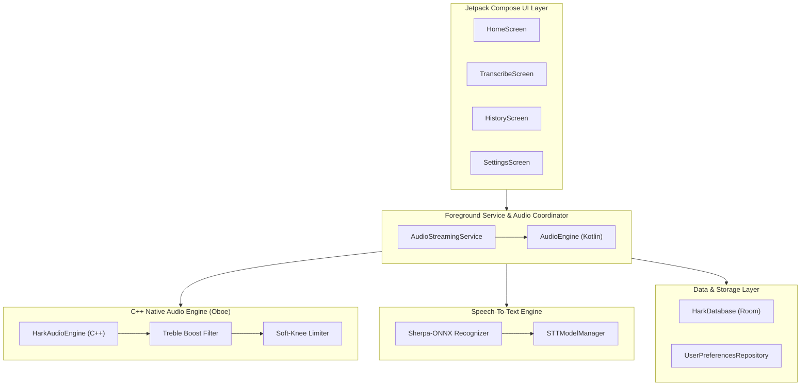

# HARK – Hearing Aid Relay Kit

[](https://developer.android.com/about/versions/pie)
[](https://kotlinlang.org/)
[](https://developer.android.com/jetpack/compose)
[](LICENSE)

**HARK** turns your Android phone into an ultra-low-latency remote microphone and real-time offline transcription streamer. It streams enhanced, processed speech directly to your hearing aids or headsets while rendering live, privacy-first on-device captions.

Designed to replace expensive proprietary "table mic" hardware accessories, HARK makes assistive listening and clear classroom or meeting speech accessible to everyone with a single tap.

---

## Features & Highlights

- **Ultra-Low Latency Audio Relay**: Native C++ audio engine built on [Google Oboe](https://github.com/google/oboe) for minimal delay between spoken voice and hearing aids.
- **Hearing Aid & Bluetooth Support**: Built specifically for **ASHA (Audio Streaming for Hearing Aids)** devices, with optional support for A2DP, SCO, and BLE headsets.
- **Custom DSP Audio Enhancement**:
  - **Bi-quad High-Shelf Treble Boost** (+8dB @ 3kHz) to enhance consonant clarity for high-frequency hearing loss.
  - **Soft-Knee Dynamic Range Limiter & Compressor** to prevent sudden loud impulse noises from damaging ears.
  - **Hardware Noise Suppression** integration.
- **100% Offline Real-Time Transcription**: Powered by **Sherpa-ONNX** with Zipformer streaming transducer models. No cloud APIs, zero network latency, complete privacy.
- **Transcript-Only Mode**: Option to mute audio relay while keeping live captions running for quiet environments.
- **Modern Material 3 UI**: Full Jetpack Compose interface featuring live visualizers, adjustable caption font size, dark/light themes, and saved history.
- **Fault Tolerant**: Automatic background stream recovery on audio route changes or screen-off events.

---

## System Architecture Overview

HARK uses a high-performance multi-tier architecture connecting native C++ DSP audio processing, Android foreground service management, offline ML inferencing, and modern Jetpack Compose state management.



For complete architectural breakdown, threading diagrams, and module responsibilities, read the **[System Architecture Guide](docs/ARCHITECTURE.md)**.

---

## Technical Documentation

Detailed documentation is available in the [`docs/`](docs/) directory:

- **[System Architecture](docs/ARCHITECTURE.md)**: Deep dive into application layers, thread boundaries, audio callbacks, and service lifecycle.
- **[Audio Processing Engine](docs/AUDIO_ENGINE.md)**: Details on native C++ Oboe integration, high-shelf biquad filter equations, soft-knee dynamics limiter formulas, and stream recovery logic.
- **[Speech-to-Text Pipeline](docs/TRANSCRIPTION_ENGINE.md)**: Complete guide to Sherpa-ONNX offline recognition, model management, audio resampling, and Room database persistence.

---

## Project Structure

```
hark-app/
├── app/
│   ├── src/main/cpp/               # Native C++ Audio Engine
│   │   ├── hark_audio_engine.h     # Oboe stream callbacks & DSP header
│   │   ├── hark_audio_engine.cpp   # Biquad filter, limiter, ring buffers
│   │   ├── jni_bridge.cpp          # JNI native interface bindings
│   │   └── CMakeLists.txt          # NDK & Oboe build configuration
│   └── src/main/java/com/thivyanstudios/hark/
│       ├── audio/                  # Audio engine Kotlin wrapper & fallbacks
│       ├── data/                   # DataStore, STT Model Manager, Room DB
│       ├── di/                     # Dependency Injection (Hilt modules)
│       ├── service/                # Foreground Service & Audio Device Routing
│       ├── ui/                     # Jetpack Compose Screens & ViewModels
│       └── util/                   # Loggers, Permissions, System Utilities
├── docs/                           # Detailed Technical Documentation
│   ├── ARCHITECTURE.md
│   ├── AUDIO_ENGINE.md
│   └── TRANSCRIPTION_ENGINE.md
└── README.md
```

---

## Building & Setup

### Prerequisites
- **Android Studio**: Ladybug / 2024.2+ or Android Studio Jellyfish+
- **Android SDK**: `compileSdk = 37`, `minSdk = 28` (Android 9.0+)
- **Android NDK**: Version 25+ with CMake 3.22+ installed via Android SDK Manager
- **JDK**: Java 11 or Java 17

### Build Steps

1. **Clone the repository**:
   ```bash
   git clone https://github.com/thivyanpillay/hark-app.git
   cd hark-app
   ```

2. **Open in Android Studio**:
   Open the project root directory in Android Studio and let Gradle sync.

3. **Build APK**:
   ```bash
   ./gradlew assembleDebug
   ```

4. **Run on Device**:
   Connect an Android phone (API 28+) via USB or Wireless ADB, and run:
   ```bash
   ./gradlew installDebug
   ```

> [!NOTE]
> For low latency audio streaming, testing on a physical Android device with ASHA-compatible hearing aids or Bluetooth headphones is recommended (Android Emulators lack native Bluetooth ASHA streaming support).

---

## Target Users

- Hearing aid users in classrooms, lectures, family dinners, or noisy environments.
- Anyone who needs an instant remote table mic without carrying extra hardware dongles.
- Optimized for devices with **ASHA (Audio Streaming for Hearing Aids)** support.

---

## Author & Credits

**Author**: Thivyan Pillay  
**LinkedIn**: [thivyan-pillay](https://www.linkedin.com/in/thivyan-pillay/)

> *"Hearing aid tech should be accessible — not locked behind overpriced accessories."*

> Built and architected with assistance from Gemini.
