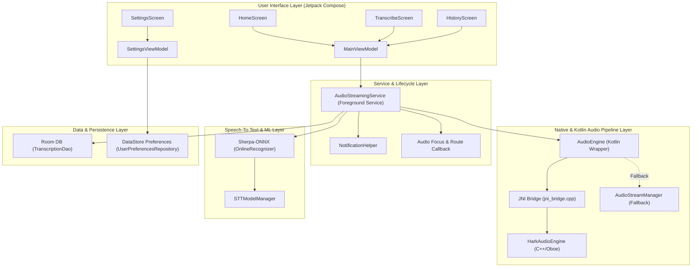

# HARK System Architecture

This document provides a comprehensive overview of the software architecture of **HARK (Hearing Aid Relay Kit)**, an Android app designed for real-time low-latency audio streaming and offline speech-to-text (STT) transcription for hearing aid users and assistive listening.

---

## High-Level System Architecture

HARK follows a layered, multi-tier architecture separating high-performance native audio processing, Android background service lifecycle management, offline machine learning inferencing, data persistence, and modern Jetpack Compose UI.

---

## Architectural Layers & Components

### 1. Native Audio Layer (`app/src/main/cpp/`)
- **[HarkAudioEngine](file:///D:/Development/hark-app/app/src/main/cpp/hark_audio_engine.h)** (`hark_audio_engine.h` / `cpp`): C++ engine using Google's **Oboe** library.
  - Manages low-latency lock-free input (`AudioStream`) and output (`AudioStream`) threads.
  - Performs DSP operations in real-time within callback handlers (`onAudioReady`).
  - Implements thread-safe ring buffers via `oboe::FifoBuffer`.
- **[jni_bridge.cpp](file:///D:/Development/hark-app/app/src/main/cpp/jni_bridge.cpp)**: JNI entry points exposing native handles and control functions to Kotlin.

### 2. Audio Abstraction Layer (`com.thivyanstudios.hark.audio`)
- **[AudioEngine.kt](file:///D:/Development/hark-app/app/src/main/java/com/thivyanstudios/hark/audio/AudioEngine.kt)**: Singleton coordinator that attempts to instantiate the C++ engine via JNI.
  - Queries system optimal sample rates and buffer sizes via `AudioManager`.
  - Attaches Android system hardware `NoiseSuppressor` using audio session IDs.
  - Fallback Mechanism: If native library loading or initialization fails, gracefully redirects processing to `AudioStreamManager`.
- **[AudioStreamManager.kt](file:///D:/Development/hark-app/app/src/main/java/com/thivyanstudios/hark/audio/stream/AudioStreamManager.kt)** & **[DefaultAudioProcessor.kt](file:///D:/Development/hark-app/app/src/main/java/com/thivyanstudios/hark/audio/processor/DefaultAudioProcessor.kt)**: Pure Java/Kotlin fallback stream engine utilizing `AudioRecord` and `AudioTrack`.

### 3. Background Service Layer (`com.thivyanstudios.hark.service`)
- **[AudioStreamingService.kt](file:///D:/Development/hark-app/app/src/main/java/com/thivyanstudios/hark/service/AudioStreamingService.kt)**: Android `ForegroundService` running with `FOREGROUND_SERVICE_TYPE_MICROPHONE`.
  - Holds a `PowerManager.WakeLock` (partial) to ensure uninterrupted audio streaming when the screen turns off.
  - Implements `AudioManager.OnAudioFocusChangeListener` to handle calls, alarms, and transient focus shifts.
  - Registers `AudioDeviceCallback` to detect ASHA hearing aids, Bluetooth headsets (A2DP/SCO/BLE), and wired headphones.
  - Runs the asynchronous STT decoding loop consuming samples from the native transcription FIFO.

### 4. Speech-To-Text (STT) Layer (`com.thivyanstudios.hark.data`)
- **[STTModelManager.kt](file:///D:/Development/hark-app/app/src/main/java/com/thivyanstudios/hark/data/STTModelManager.kt)**: Asynchronously downloads, validates, and manages local ONNX models (e.g., Zipformer streaming models from HuggingFace).
- **Sherpa-ONNX Engine**: Embedded C++/Java binding library running `OnlineRecognizer` with streaming transducer architecture for real-time offline transcription without internet dependencies.

### 5. Persistence Layer (`com.thivyanstudios.hark.data`)
- **[UserPreferencesRepository.kt](file:///D:/Development/hark-app/app/src/main/java/com/thivyanstudios/hark/data/UserPreferencesRepository.kt)**: Jetpack DataStore Preferences managing microphone gain, DSP toggles, font size, and device compatibility flags.
- **[HarkDatabase.kt](file:///D:/Development/hark-app/app/src/main/java/com/thivyanstudios/hark/data/local/HarkDatabase.kt)** & **[TranscriptionRepository.kt](file:///D:/Development/hark-app/app/src/main/java/com/thivyanstudios/hark/data/TranscriptionRepository.kt)**: Room database maintaining persistent transcription history.

### 6. User Interface Layer (`com.thivyanstudios.hark.ui`)
- Built entirely with **Jetpack Compose** and **Material 3**.
- State management driven by **Hilt**-injected ViewModels ([MainViewModel](file:///D:/Development/hark-app/app/src/main/java/com/thivyanstudios/hark/ui/viewmodel/MainViewModel.kt), [SettingsViewModel](file:///D:/Development/hark-app/app/src/main/java/com/thivyanstudios/hark/ui/viewmodel/SettingsViewModel.kt)).
- Declarative navigation via `androidx.navigation.compose`.

---

## Threading & Concurrency Model

| Thread / Context | Execution Model & Tech | Responsibilities & Constraints |
| :--- | :--- | :--- |
| **Real-time Audio Thread** | Native C++ / Oboe Callback | • High priority real-time execution • Zero heap allocations (`new`/`malloc`) inside callback • Lock-free parameter updates via `std::atomic` • Reads mic input $\rightarrow$ DSP processing $\rightarrow$ Writes output FIFO & Transcription FIFO |
| **IO Coroutine Dispatcher** | Kotlin Coroutines (`Dispatchers.IO`) | • Background loop polling native transcription FIFO • Passes PCM samples to Sherpa-ONNX `acceptWaveform` • Asynchronous model downloads via OkHttp • Room Database reads/writes & DataStore Preferences IO |
| **Main Thread / UI Thread** | Android Main (`Dispatchers.Main`) | • Jetpack Compose UI rendering & user touch input • Collects `StateFlow` streams from ViewModels • Material 3 layout & navigation updates |

1. **Audio Hardware Callbacks**: Executed on high-priority real-time threads managed by Oboe. No memory allocations (`new`/`malloc`) or locking primitives are permitted inside `onAudioReady`. Dynamic parameters (`mGain`, DSP flags) use `std::atomic<T>`.
2. **Transcription Processing**: Executed on `Dispatchers.IO` via Kotlin Coroutines inside `AudioStreamingService`. Continuously polls `nativeReadTranscriptionData` without blocking the audio callback thread.
3. **UI Rendering**: Jetpack Compose observes `StateFlow` instances exposed by ViewModels on `Dispatchers.Main`.

---

## Device Routing & Compatibility

- **ASHA (Audio Streaming for Hearing Aids)**: Android's native hearing aid protocol. HARK routes audio as accessibility speech (`USAGE_ASSISTANCE_ACCESSIBILITY`).
- **Bluetooth Headsets**: Supports A2DP, SCO, wired headsets, and BLE Audio devices when Bluetooth Headset Support is enabled in settings.
- **Route Changes**: Disconnections or screen-off stream tear-downs are safely caught by Oboe's `onErrorAfterClose`, triggering background automatic retry threads (`restartStreams`).
