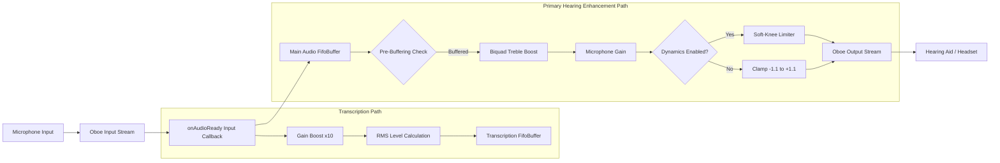
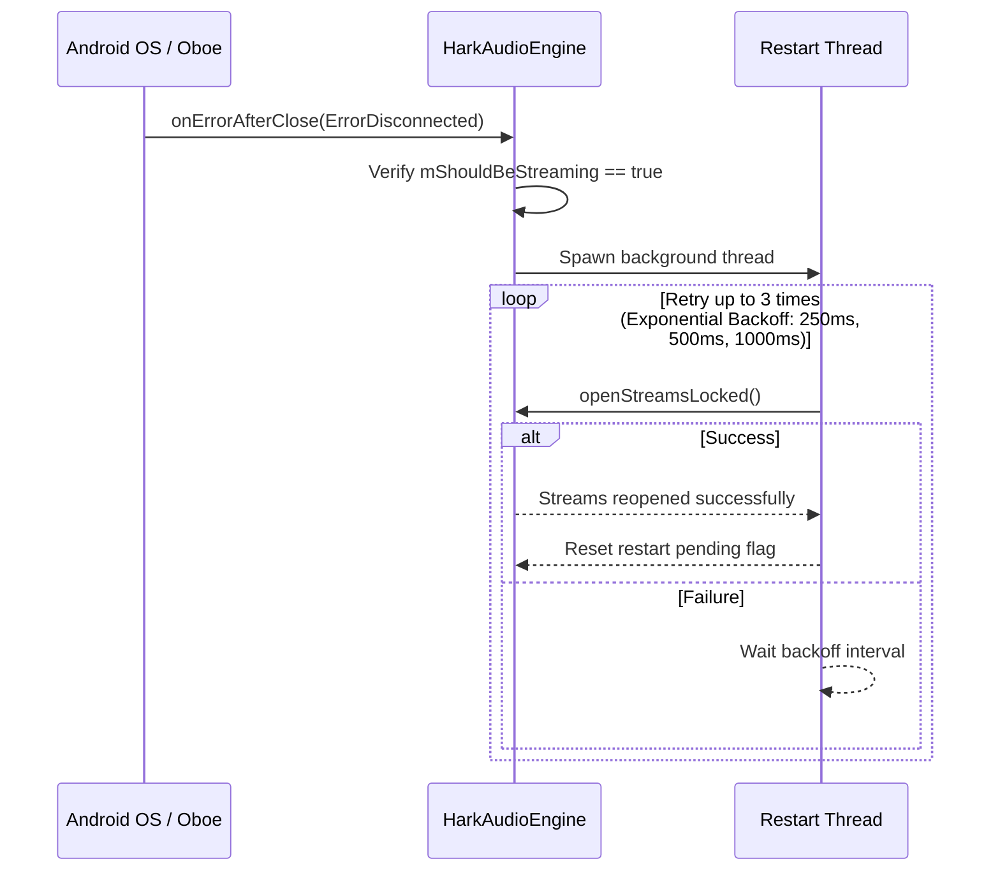

# HARK Audio Processing Engine

This document details the low-latency C++ native audio engine (**HarkAudioEngine**), Digital Signal Processing (DSP) algorithms, and stream fault-tolerance built into HARK.

---

## Engine Overview

The core audio engine ([hark_audio_engine.cpp](file:///D:/Development/hark-app/app/src/main/cpp/hark_audio_engine.cpp) / [hark_audio_engine.h](file:///D:/Development/hark-app/app/src/main/cpp/hark_audio_engine.h)) is written in C++17 utilizing **Google Oboe**. It provides high-efficiency, low-latency audio capture and playback with real-time DSP filters tailored for hearing enhancement.

### Key Performance Goals
- **Ultra-low latency**: Hardware-direct AAudio/OpenSL ES performance mode (`oboe::PerformanceMode::LowLatency`).
- **Zero dynamic memory allocation in callback**: Pre-allocated buffers prevent Garbage Collection (GC) pauses and audio glitches.
- **Thread safety**: Lock-free parameter updates using C++ atomics (`std::atomic`).

---

## Signal Processing Flow

---

## DSP Signal Processing Algorithms

### 1. High-Shelf Treble Boost Filter (Biquad)

High-frequency boost improves speech intelligibility by enhancing consonants (e.g., *s*, *f*, *th*, *t*) which are often difficult to hear for individuals with high-frequency hearing loss.

- **Filter Type**: 2nd Order Biquad High-Shelf Filter
- **Center Frequency ($f_0$)**: $3000\text{ Hz}$
- **Gain**: $+8.0\text{ dB}$

#### Coefficient Equations
Calculated dynamically based on sample rate ($f_s$):

$$\omega_0 = 2\pi \frac{f_0}{f_s}, \quad A = 10^{\frac{\text{gainDb}}{40}}, \quad \alpha = \frac{\sin(\omega_0)}{2}$$

$$a_0 = (A + 1) - (A - 1)\cos(\omega_0) + 2\sqrt{A}\alpha$$

$$b_0 = \frac{A \cdot ((A + 1) + (A - 1)\cos(\omega_0) + 2\sqrt{A}\alpha)}{a_0}$$

$$b_1 = \frac{-2 A \cdot ((A - 1) + (A + 1)\cos(\omega_0))}{a_0}$$

$$b_2 = \frac{A \cdot ((A + 1) + (A - 1)\cos(\omega_0) - 2\sqrt{A}\alpha)}{a_0}$$

$$a_1 = \frac{2 \cdot ((A - 1) - (A + 1)\cos(\omega_0))}{a_0}$$

$$a_2 = \frac{(A + 1) - (A - 1)\cos(\omega_0) - 2\sqrt{A}\alpha}{a_0}$$

#### Direct Form I Difference Equation
$$y[n] = b_0 \cdot x[n] + b_1 \cdot x[n-1] + b_2 \cdot x[n-2] - a_1 \cdot y[n-1] - a_2 \cdot y[n-2]$$

---

### 2. Dynamics Processing: Soft-Knee Limiter & Compressor

To protect hearing aid users from sudden loud noises (such as clattering dishes or doors slamming), the engine applies an envelope-following soft-knee gain limiter.

- **Threshold**: $0.75$ (linear amplitude)
- **Knee Width**: $0.15$
- **Attack Coefficient**: $0.05$ (~$0.4\text{ ms}$ attack at $48\text{ kHz}$)
- **Release Coefficient**: $0.0005$ (~$40\text{ ms}$ release at $48\text{ kHz}$)

#### Envelope Follower
$$E[n] = \begin{cases} 
|x[n]| \cdot \text{attack} + E[n-1] \cdot (1 - \text{attack}) & \text{if } |x[n]| > E[n-1] \\ 
|x[n]| \cdot \text{release} + E[n-1] \cdot (1 - \text{release}) & \text{if } |x[n]| \le E[n-1] 
\end{cases}$$

#### Soft-Knee Target Gain Calculation
$$G_{\text{target}} = \begin{cases} 
1.0 & \text{if } E[n] \le \text{Threshold} - \frac{\text{Knee}}{2} \\ 
\frac{\text{Threshold}}{E[n]} & \text{if } E[n] \ge \text{Threshold} + \frac{\text{Knee}}{2} \\ 
\frac{E[n] - \frac{\left(E[n] - (\text{Threshold} - \frac{\text{Knee}}{2})\right)^2}{2 \cdot \text{Knee}}}{E[n]} & \text{otherwise (Soft Knee Region)} 
\end{cases}$$

$$y[n] = x[n] \cdot G_{\text{target}}$$

---

### 3. Pre-Buffering & Jitter Absorption

Audio clocks on mobile microphones and Bluetooth output endpoints can drift slightly. To eliminate audible popping or snapping due to buffer underruns:
1. The engine starts in `mIsBuffering = true` mode.
2. It accumulates audio frames in `mFifoBuffer` until at least `4 * framesPerBurst` are available.
3. If an underrun occurs during streaming (`framesRead < numFrames`), output buffers are zero-padded and pre-buffering re-engages seamlessly.

---

### 4. Transcription Signal Pipeline

- Dedicated 10-second `mTranscriptionFifo` buffer independent of output streaming.
- Applies a 10x signal boost to transcription inputs to enable speech recognition in quiet environments.
- Computes exponential moving average Root-Mean-Square (RMS) audio energy level (`mTranscriptionLevel`) at 20fps for UI speech indicators and gating.

---

## Stream Recovery & Fault Tolerance

On Android, exclusive low-latency streams are torn down by the OS whenever audio routing changes (e.g., connecting a Bluetooth headset) or when the screen turns off.

---

## Java/Kotlin Fallback Engine

If the native C++ library fails to load or cannot initialize hardware streams on non-standard Android hardware, [AudioEngine.kt](file:///D:/Development/hark-app/app/src/main/java/com/thivyanstudios/hark/audio/AudioEngine.kt) automatically falls back to:
- **[AudioStreamManager.kt](file:///D:/Development/hark-app/app/src/main/java/com/thivyanstudios/hark/audio/stream/AudioStreamManager.kt)**: Manages Java `AudioRecord` (Input) and `AudioTrack` (Output) initialized with `USAGE_ASSISTANCE_ACCESSIBILITY` and `PERFORMANCE_MODE_LOW_LATENCY`.
- **[DefaultAudioProcessor.kt](file:///D:/Development/hark-app/app/src/main/java/com/thivyanstudios/hark/audio/processor/DefaultAudioProcessor.kt)**: Pure Kotlin PCM float processing fallback.
