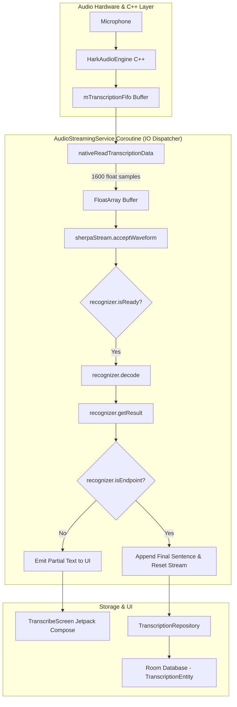

# HARK Speech-to-Text (STT) & Transcription Pipeline

This document details the offline, privacy-first Speech-to-Text (STT) engine, model management, real-time decoding loop, and Room persistence integrated into HARK.

---

## Overview

HARK provides live continuous transcription of spoken audio directly on-device without requiring an internet connection or cloud API calls. This allows hearing-impaired users to read live captions in noisy classrooms, lectures, or meetings.

### Key Capabilities
- **100% On-Device & Private**: No audio data or transcripts leave the phone.
- **Low Latency Streaming**: Powered by **Sherpa-ONNX** with Zipformer streaming transducer models.
- **Continuous Endpointing**: Automatic sentence segmentation and real-time caption updates.

---

## Pipeline Architecture



---

## Model Management (`STTModelManager`)

The STT system uses modular streaming models packaged into 4 ONNX files:
1. `encoder-epoch-99-avg-1.onnx`: Audio feature encoder network.
2. `decoder-epoch-99-avg-1.onnx`: Embedding decoder network.
3. `joiner-epoch-99-avg-1.onnx`: Transducer joiner network combining encoder and decoder states.
4. `tokens.txt`: Vocabulary token map.

### Built-in Model Definition
- **Name**: Streaming Zipformer (English)
- **Source**: `sherpa-onnx-streaming-zipformer-en-2023-02-21`
- **Download Source**: HuggingFace (`csukuangfj/sherpa-onnx-streaming-zipformer-en-2023-02-21`)

### Download & File Storage
- Models are downloaded asynchronously using `OkHttp` with stream progress callbacks (`_downloadProgress`).
- Files are saved directly to internal app storage (`context.filesDir`).
- `STTModelManager` verifies presence of all 4 component files via `isModelDownloaded()`.

---

## Sherpa-ONNX Recognition Engine Configuration

Inside [AudioStreamingService.kt](file:///D:/Development/hark-app/app/src/main/java/com/thivyanstudios/hark/service/AudioStreamingService.kt), the recognizer is initialized with:

```kotlin
val config = OnlineRecognizerConfig()

// Model paths
config.modelConfig.transducer.encoder = File(filesDir, model.encoderFileName).absolutePath
config.modelConfig.transducer.decoder = File(filesDir, model.decoderFileName).absolutePath
config.modelConfig.transducer.joiner = File(filesDir, model.joinerFileName).absolutePath
config.modelConfig.tokens = File(filesDir, model.tokensFileName).absolutePath

// Decoding & Feature Config
config.decodingMethod = "modified_beam_search"
config.maxActivePaths = 4
config.featConfig.sampleRate = 16000
config.featConfig.featureDim = 80
config.modelConfig.numThreads = prefs.whisperThreads // Configurable (default: 4)

// Endpoint Rules (Silence Detection)
config.enableEndpoint = true
config.endpointConfig.rule1.minTrailingSilence = 1.5f  // Long silence threshold
config.endpointConfig.rule2.minTrailingSilence = 0.8f  // Short silence threshold
```

---

## Real-time Audio Streaming Loop

1. **Buffer Polling**: Every 30 ms, the service calls `audioEngine.readTranscriptionData(audioBuffer)` to pull up to 3200 PCM float samples (100 ms chunks) from the C++ FIFO.
2. **Resampling & Feature Extraction**: The PCM float array is passed into `sherpaStream.acceptWaveform(activeSamples, sampleRate = inputSampleRate)`. Sherpa automatically resamples input hardware rates (e.g. 48 kHz) to the expected 16 kHz model feature rate.
3. **Beam Search Decoding**: While `recognizer.isReady(sherpaStream)` returns true, `recognizer.decode(sherpaStream)` processes frame batches.
4. **Partial Result Updates**: `recognizer.getResult(sherpaStream)` updates `_transcription` StateFlow to provide real-time visual feedback on screen.
5. **Endpoint Detection**: When `recognizer.isEndpoint(sherpaStream)` detects trailing silence (0.8s - 1.5s), the sentence is finalized into `fullTranscript` and `recognizer.reset(sherpaStream)` clears decoder memory for the next sentence.

---

## Persistence & History Management

Transcriptions can be saved directly from the UI into local storage.

### Database Schema
- **Database**: [HarkDatabase](file:///D:/Development/hark-app/app/src/main/java/com/thivyanstudios/hark/data/local/HarkDatabase.kt) (Room DB v1)
- **Table**: `transcriptions`
- **Entity**: [TranscriptionEntity](file:///D:/Development/hark-app/app/src/main/java/com/thivyanstudios/hark/data/local/TranscriptionEntity.kt)
  - `id: Long` (Auto-generate Primary Key)
  - `text: String`
  - `timestamp: Long` (System epoch timestamp)

### Repository Operations ([TranscriptionRepository](file:///D:/Development/hark-app/app/src/main/java/com/thivyanstudios/hark/data/TranscriptionRepository.kt))
- `allTranscriptions: Flow<List<TranscriptionEntity>>`: Reactive flow sorted by timestamp descending.
- `insert(text: String)`: Inserts new transcript entry.
- `delete(id: Long)`: Deletes individual entry by ID.
- `deleteAll()`: Clears transcript history.
